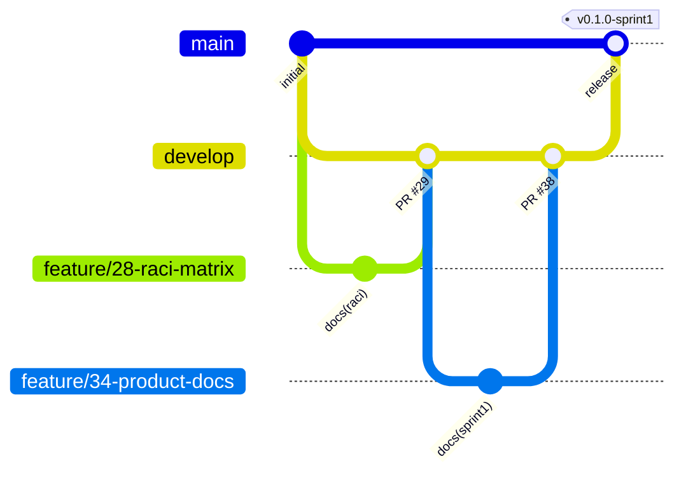

# Bookademic – Git-Flow and Repository Workflow

This document defines how the team uses Git and GitHub. Every rule here is applied in the [`bookademic-team/Bookademic`](https://github.com/bookademic-team/Bookademic) repository, so each member's work stays traceable from the backlog to the code.

## 1. Branch model



| Branch | Purpose | Created from | Merged into | Protected |
|---|---|---|---|---|
| `main` | Released versions only; every commit on `main` is a sprint release | – | – | Yes |
| `develop` | Integration branch; the default branch of the repository | `main` | `main` (release) | Yes |
| `feature/<issue-no>-<short-name>` | One task: a story, enabler or document | `develop` | `develop` | No |
| `fix/<issue-no>-<short-name>` | Correction of something already merged into `develop` | `develop` | `develop` | No |
| `hotfix/<issue-no>-<short-name>` | Urgent correction of a released version (not used yet) | `main` | `main` and `develop` | No |

**Naming rules**

- Lowercase, words separated by hyphens, the Issue number first: `feature/46-fix-doc-paths`, `feature/39-api-adr-alignment`.
- One branch per Issue. Work for a new Issue starts on a new branch from the latest `develop`.
- Branches are **not deleted** after merging, so each member's history stays visible.

## 2. Branch protection

`main` and `develop` are protected in the repository settings:

- No direct pushes; changes arrive only through a pull request.
- At least **one approving review** from another team member is required before merging.
- Nobody approves their own pull request.

## 3. From Issue to merge

1. **Issue.** Every user story, enabler, document or fix is a GitHub Issue with an English title (`US-18: …`, `EN-03: …`, `docs: …`). It has an assignee, the `Sprint N` milestone when it belongs to the current sprint, and labels (§5). The Issue is added to the GitHub Projects board.
2. **Branch.** From the Issue page, *Development → Create a branch*, with `develop` as the source.
3. **Commits.** Small commits in English that follow §4 and end with the Issue number.
4. **Pull request.** Base `develop`, compare the feature branch. The description says what changed and contains `Closes #<issue-no>`. The reviewer is assigned according to the review plan, and the PR gets the same milestone and project as its Issue.
5. **Review.** The reviewer checks the change against the backlog, the OpenAPI contract and the other documents, writes **at least one comment**, and submits the review as **Approve** or **Request changes**. A plain comment does not count as an approval.
6. **Merge.** After approval, the PR is merged with **"Create a merge commit"**. Squash and rebase merges are not used, so every commit keeps its author.
7. **Close.** `Closes #<issue-no>` closes the Issue automatically when the PR is merged into `develop`. If an Issue is closed or left open by mistake, it is corrected by hand with a comment explaining why.

## 4. Commit messages

[Conventional Commits](https://www.conventionalcommits.org/) in English:

```text
<type>(<scope>): <summary> (#<issue-no>)
```

| Type | Used for | Example |
|---|---|---|
| `feat` | New functionality | `feat(M2): add overlap check for reservations (#10)` |
| `fix` | Bug fix | `fix(M4): reject topic notes shorter than 10 characters (#22)` |
| `docs` | Documentation only | `docs(raci): add US-23 and US-07, align ADR row (#46)` |
| `test` | Tests only | `test(M2): cover back-to-back intervals (#11)` |
| `chore` / `ci` | Build, tooling, CI | `ci: add coverage threshold to GitHub Actions (#4)` |

The scope is a module (`M1`–`M4`) or a document (`raci`, `api`, `adr`, `qa`, `ui`, `meetings`).

## 5. Labels and board

| Label group | Values | Meaning |
|---|---|---|
| Module | `M1-identity`, `M2-core`, `M3-lab`, `M4-office-hours` | Module that owns the story |
| Priority | `must`, `should` | MoSCoW priority from the backlog |
| Epic | `epic-E1` … `epic-E10` | Epic the story belongs to |
| Estimate | `sp-2`, `sp-3`, `sp-5`, `sp-8` | Story points |
| Type | `enabler`, `devops`, `documentation` | Non-story work |

Issues are created and kept in sync with [`backlog.md`](backlog.md) through [`issues.csv`](issues.csv) and [`sync_issues.py`](sync_issues.py). The GitHub Projects board shows every Issue and PR with the columns **Backlog → Sprint → In progress → Review → Done**.

## 6. Releases and tags

At the end of each sprint:

1. All Sprint `N` pull requests are merged into `develop`, and the Sprint `N` milestone has no open Issues.
2. A release pull request **`develop` → `main`** is opened and approved by the Scrum Master (at least one approval, merge commit).
3. A tag is created on `main` with a GitHub Release whose notes list the deliverables and links:

| Sprint | Tag |
|---|---|
| Sprint 1 | `v0.1.0-sprint1` |
| Sprint 2 | `v0.2.0-sprint2` |
| Sprint 3 | `v0.3.0-sprint3` |
| Final | `v1.0.0` |

## 7. Definition of Done

A task is done when:

- its pull request is linked to the Issue (`Closes #<issue-no>`) and merged into `develop` with a merge commit,
- it has at least one approving review with a comment,
- tests are written for code changes (from Sprint 3, CI must pass with at least 50% coverage),
- it is consistent with the OpenAPI contract and the backlog,
- the Issue is closed and shown as **Done** on the board.
