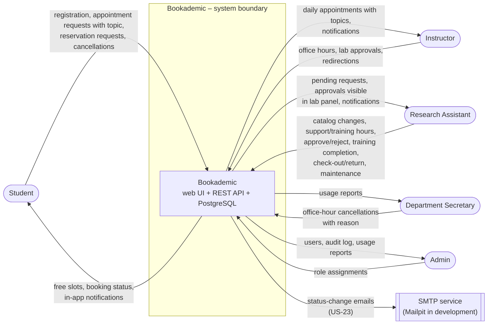

# Bookademic – System Vision and Boundaries (Sprint 1)

**Owner:** Melih (Product Owner & Requirements Engineer)

## 3. System vision and boundaries

**Vision:** A department where every student working on a project can reach their instructor, their assistant and the laboratory without waiting, without getting lost, and from a single place.

**Target users:** Student, Instructor (faculty member), Research Assistant, Department Secretary, Admin.

### 3.1 System responsibilities and core functions

1. Authenticate users and authorize them according to 5 roles.
2. Manage resources (devices, rooms) and time slots (office hours, assistant support hours, device training hours).
3. Pass every reservation and appointment through the shared conflict check and advance it according to the state machine.
4. Make lab access depend on two conditions: the instructor's academic approval and the device training authorization.
5. Track check-out/return and maintenance status of lab devices.
6. Manage cancellation of office hours and redirection of appointments to the assistant.
7. Record status changes, notify the people concerned (in-app, and by email as a Should feature) and report usage.

### 3.2 In scope / out of scope

| Category | In scope | Out of scope |
|---|---|---|
| Identity and access | Registration with school email, JWT login, 5 roles (RBAC) | University SSO/LDAP integration |
| Reservation core | Time-slot selection, conflict check (409), approve/reject, cancellation, status history, unified calendar | Recurring reservations, waiting list |
| Laboratory | Device/room catalog, academic lab approval, device training authorization, check-out/return code, maintenance status | Smart door locks/IoT, paid rental, repair process |
| Office hours | Instructor office hours, assistant support and training hours; appointments with a topic note; redirection to the assistant; secretary cancellation | Live queue, video meetings, messaging |
| Notifications and administration | In-app notifications, email notifications (Should), audit log, usage report, admin user management | Mobile app, push notifications, SMS |
| Platform | Single department, English UI, single-command Docker setup | Multiple universities, calendar sync (iCal/Google) |

### 3.3 System context and external interactions

- **Users → Bookademic:** The five roles connect over HTTPS with a web browser; the frontend calls the REST API.
- **Bookademic → SMTP service:** The only external system, used for status-change emails (US-23: approval, rejection, cancellation, redirection). In development a fake SMTP server (**Mailpit**, per ADR-0001) is used.
- **Bookademic → PostgreSQL:** The system's own database (inside the system boundary).
- University SSO and calendar applications are not connected in this release.

**Context diagram.** The system is a single box; the five actors and the SMTP service are outside the boundary. Each arrow names the information it carries.

### 3.4 Constraints

- The system must run with a single command: `docker compose up`.
- All APIs are defined first in the OpenAPI contract (API-first).
- A lab reservation cannot be created unless the approval and training conditions are met (enforced on the server; hiding it in the UI is not enough).
- Resource list response: **p95 < 200 ms with a 500-record test dataset**.
- Personal data is limited to name, school email and role (data minimization for KVKK).

### 3.5 Actors and main use cases

Every main use case involves at least 3 actors. The SMTP service is an external system actor. **UC-6, UC-7 and UC-8 are supporting use cases**; having two actors is normal for them.

| Use case | Flow | Actors | Stories |
|---|---|---|---|
| UC-1 Get lab access approval | The student books an office-hour appointment; the instructor grants a category-based approval from the meeting; the research assistant sees the approval in the lab panel | Student, Instructor, Research Assistant | US-13, US-18 |
| UC-2 Complete device training | The student books a training slot; the research assistant completes the training; the system grants authorization; the instructor who granted the approval is notified | Student, Research Assistant, Instructor | US-14, US-17, US-04 |
| UC-3 Reserve and check out a lab device | The student opens a request (approval + authorization check, conflict check); the research assistant approves and hands over the device; the instructor who granted the approval is notified | Student, Research Assistant, Instructor | US-06, US-08, US-15, US-04 |
| UC-4 Cancel office hours | The instructor reports they cannot come or the secretary cancels; students with appointments are notified | Department Secretary, Instructor, Student | US-20, US-04 |
| UC-5 Redirect an appointment to the assistant | The instructor moves a homework/lab question to the assistant's support hours; the student sees the new appointment | Instructor, Research Assistant, Student | US-21 |
| UC-6 Put a device under maintenance *(supporting)* | The research assistant puts the device under maintenance; future reservations are cancelled; the affected students are notified | Research Assistant, Student | US-16 |
| UC-7 Report usage *(supporting)* | The secretary and the admin see device and office-hour usage | Department Secretary, Admin | US-05 |
| UC-8 Account and role management *(supporting)* | The student registers; the admin assigns staff roles | Student, Admin | US-01, US-02, US-03 |
