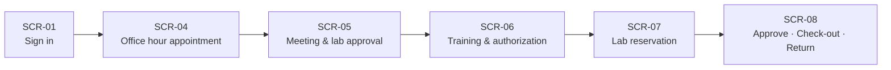

# Bookademic — Screen List and Screen Flow

| Field | Value |
|---|---|
| File | `docs/ui-screens.md` |
| Sprint | 1 (Sprint 2 preparation) |
| Author | Emir (M4 – Office Hours & Support) |
| Related modules | M1 (Identity), M2 (Reservation & Calendar), M3 (Laboratory), M4 (Office Hours & Support) |
| Sources | Sprint 1 document §1.4, §3.5, §7 (backlog), `docs/api/openapi.yaml` (v0.2.2) |
| Language rule | All UI text and documentation are in English, as are screen codes, API paths, field names and enum values. |
| Single source of truth | API paths and field names in this document follow `openapi.yaml`. If the contract changes, this document is updated to match. |

## 1. Purpose and scope

This document defines which screens exist, which story each one serves, which API each one calls, and how the main project journey flows across screens for Bookademic's 5 actors. In Sprint 2, frontend work follows this document and the OpenAPI contract, and can proceed with mock data (Prism mock server) until M2/M3 are ready.

**Out of scope:** pixel-level visual design, mobile app, live queue, messaging (see Sprint 1 document §3.2).

## 2. Design principles

1. **Server rules are authoritative.** Lab approval, training authorization and conflict checks are enforced on the server (§3.4). The UI does not rely on hiding buttons; it turns server errors into clear English messages, chosen by the `code` field of the error response (see §8).
2. **Role-based menu.** Users only see screens their role can access; an unauthorized URL shows a 403 page, a missing token redirects to SCR-01.
3. **Every list screen defines 4 states:** loading, empty, error, populated.
4. **Topic note is mandatory** (10–500 characters, with live counter); letting the instructor prepare for the meeting is a core goal of the project.
5. **Data minimization (KVKK/GDPR-style):** screens show only name, school e-mail and role.
6. **Performance:** the resource list responds with p95 < 200 ms on a 500-record test dataset (US-12); filter changes do not reload the page.
7. **In-app notifications** (e.g. cancellation, authorization granted) are shown in a shared notification center in the page header (see CMP-01).

## 3. Role – screen access matrix

| Screen | Student | Instructor | Research Assistant | Secretary | Admin |
|---|:-:|:-:|:-:|:-:|:-:|
| SCR-01 Sign In & Register | ✔ | ✔ | ✔ | ✔ | ✔ |
| SCR-02 Calendar & My Appointments | ✔ | – | – | – | – |
| SCR-03 Office Hours Management | – | ✔ | ✔ | – | – |
| SCR-04 Book Appointment | ✔ | – | – | – | – |
| SCR-05 Daily Appointments & Lab Approval | – | ✔ | – | – | – |
| SCR-06 Device Training & Authorization | ✔ | – | ✔ | – | – |
| SCR-07 Lab Catalog & Reservation | ✔ | – | – | – | – |
| SCR-08 Lab Management & Check-out/Return | – | – | ✔ | – | ✔ |
| SCR-09 Secretary & Admin Management | – | – | – | ✔ | ✔ |
| SCR-10 Redirect & Help Request | ✔ | ✔ | – | – | – |
| SCR-11 Device/Room Catalog Management | – | – | ✔ | – | ✔ |

Note: Instructors and research assistants see their own appointments inside SCR-05 / SCR-06 / SCR-03. The "Calendar" (US-10) is student-specific ("only their own records"). The notification center (CMP-01) is available to all signed-in roles.

## 4. Screen list

All paths are relative to the base URL `http://localhost:8080/api/v1`.

| Code | Screen | Role | Story | Priority | Main API (per OpenAPI v0.2.2) |
|---|---|---|---|---|---|
| SCR-01 | Sign In & Register | All users | US-01, US-02 | Must | `POST /auth/register`, `POST /auth/login`, `GET /users/me` |
| SCR-02 | Calendar & My Appointments | Student | US-10, US-09 | Calendar: Should · Cancel: Must | `GET /me/calendar`, `GET /appointments/my`, `POST /reservations/{reservationId}/cancel` |
| SCR-03 | Office Hours Management | Instructor, Research Assistant | US-17 | Must | `POST /office-hours`, `GET /office-hours` |
| SCR-04 | Book Appointment | Student | US-18 | Must | `GET /office-hours`, `GET /office-hours/{scheduleId}/slots`, `POST /appointments` |
| SCR-05 | Daily Appointments & Lab Approval | Instructor | US-19, US-13 | Must | `GET /appointments/incoming`, `POST /lab-approvals` |
| SCR-06 | Device Training & Authorization | Student, Research Assistant | US-18, US-14 | Must | `POST /appointments`, `GET /appointments/incoming`, `POST /training-authorizations`, `GET /training-authorizations` |
| SCR-07 | Lab Catalog & Reservation | Student | US-12, US-06 | Must | `GET /resources`, `POST /reservations`, `GET /lab-approvals`, `GET /training-authorizations` |
| SCR-08 | Lab Management & Check-out/Return | Research Assistant, Admin | US-08, US-13, US-15, US-16 | US-08, US-13: Must · others: Should | `GET /reservations?kind=LAB&status=PENDING`, `POST /reservations/{reservationId}/approve`, `POST /reservations/{reservationId}/reject`, `GET /lab-approvals`, check-out/return and maintenance endpoints (§6) |
| SCR-09 | Secretary & Admin Management | Secretary, Admin | US-20, US-05, US-03 | US-20: Must · others: Should | `POST /office-hours/{scheduleId}/cancellations`, `GET /reports/usage`, `PUT /admin/users/{userId}/role` |
| SCR-10 | Redirect & Help Request | Instructor, Student | US-21, US-22 | Should | `POST /appointments/{appointmentId}/redirect`, `POST /appointments` (`relatedReservationId`) |
| SCR-11 | Device/Room Catalog Management | Research Assistant, Admin | US-11 | Must | `POST /resources`, `PUT /resources/{resourceId}` |
| CMP-01 | Notification Center (header component) | All signed-in roles | US-04 | Must (in-app) | `GET /notifications` |

## 5. Main journey screen flow (MVP demo)

Alternative flows: SCR-09 ⇢ SCR-02 (secretary cancellation) · SCR-07 / SCR-02 ⇢ SCR-10 (help appointment if stuck).

| Step | Screen | Actor | Action | Success result | Error cases (`code`) |
|---|---|---|---|---|---|
| 0 | SCR-01 | Student | Registers/signs in with school e-mail | 200 + JWT, role-appropriate home page | `EMAIL_DOMAIN_NOT_ALLOWED` (400) · `EMAIL_ALREADY_REGISTERED` (409) · `UNAUTHORIZED` (401) |
| 1 | SCR-04 | Student | Picks an instructor and a free slot, writes the topic note (e.g. "I need an oscilloscope for my project") | 201, appointment created as `APPROVED` (auto-approved when the slot is free) | `VALIDATION_ERROR` (400, topic note outside 10–500 characters) · `SLOT_UNAVAILABLE` (409) · `DAILY_APPOINTMENT_LIMIT` (409, second appointment with the same instructor on the same day) |
| 2 | SCR-05 | Instructor | Sees the day's appointments with their topics; after the meeting grants a lab access approval with device category + end date | Approval is linked to the appointment; the research assistant sees it in the lab panel | `VALIDATION_ERROR` (400, missing category/date) · `FORBIDDEN` (403) |
| 3 | SCR-06 | Student → Research Assistant | Student books a TRAINING slot; after the session the research assistant clicks "Complete training" | Appointment becomes `COMPLETED`, category-based device authorization is created; the approving instructor is notified | `TRAINING_ALREADY_GRANTED` (409) · `NOT_A_TRAINING_APPOINTMENT` (400) · `SLOT_UNAVAILABLE` (409) |
| 4 | SCR-07 | Student | Filters the catalog, selects a device and time range, submits a request | 201 + `PENDING` | `INVALID_INTERVAL` (400) · `LAB_APPROVAL_REQUIRED` (403) · `TRAINING_REQUIRED` (403) · `RESOURCE_IN_MAINTENANCE` (409) · `SLOT_UNAVAILABLE` (409) |
| 5 | SCR-08 | Research Assistant | Approves/rejects the pending request (rejection reason mandatory); hands over the device with a check-out code and takes it back on return | `APPROVED` → `CHECKED_IN` → `COMPLETED` (check-out/return is Should) | `INVALID_STATE_TRANSITION` (409, only PENDING requests can change) · `INVALID_HANDOVER_CODE` (400) |

**MVP scope note:** steps 1–4 and the approval part of step 5 are Must; check-out/return (US-15) is Should.

### 5.1 Alternative flows

| Code | Flow (use case) | Screens | Summary |
|---|---|---|---|
| A1 | Cancel an office hour (UC-4, US-20) | SCR-09 → SCR-02 | The secretary (or the owner) cancels a schedule for a given day with a reason; all appointments that day become `CANCELLED`; students are notified, and cancelled items appear separately in SCR-02. |
| A2 | Redirect to assistant (UC-5, US-21) | SCR-05 → SCR-10 → SCR-02 | The instructor moves an appointment to the research assistant's support hour; the old appointment becomes `CANCELLED` and a new one is created; the student sees the new appointment. `NO_AVAILABLE_SLOT` (409) if there is no free slot. |
| A3 | Help appointment (US-22) | SCR-07 / SCR-02 → SCR-10 | A student opens a support appointment only for their own `APPROVED` / `CHECKED_IN` reservation; reservation details are attached automatically. |
| A4 | Put a device into maintenance (UC-6, US-16) | SCR-08 → SCR-02 | A device in maintenance cannot be reserved (`RESOURCE_IN_MAINTENANCE`); future reservations are cancelled and their owners are notified. |
| A5 | Usage report / role assignment (UC-7, UC-8) | SCR-09 | Occupancy and cancellation report with a date-range filter; the admin assigns roles to staff. |
| A6 | Cancel a reservation/appointment (US-09) | SCR-02 | A student cancels their own record before it starts; the slot becomes free. |

## 6. Screen details

### SCR-01 — Sign In & Register

- **Fields:** school e-mail, password, (register) full name.
- **Validation:** school e-mail domain check; `EMAIL_DOMAIN_NOT_ALLOWED` → "Only school e-mail addresses are accepted."
- **Behavior:** after sign-in the JWT is stored, the role is read with `GET /users/me`, and the user is routed to the home page for their role.
- **States:** loading (button disabled) · 401 · 409.

### SCR-02 — Calendar & My Appointments (Student)

- **Components:** this week's chronological calendar list (`GET /me/calendar`) and the "My Appointments" list with its separate cancelled section (`GET /appointments/my`, optional `status` filter); type tag (Office Hour / Training / Support / Lab Reservation); status badge; "Cancel" button (only before the start time).
- **Cancel:** appointments and lab reservations are cancelled with the same endpoint, `POST /reservations/{reservationId}/cancel` (an appointment's id is the id of its underlying reservation). If the record has already started, the server returns `CANCELLATION_WINDOW_PASSED` (409).
- **Rule:** only the student's own records; cancelled items are shown in a separate section.
- **Empty state:** "You have no records this week. You can book an appointment from an office hour." + link to SCR-04.

### SCR-03 — Office Hours Management (Instructor, Research Assistant)

- **Form (`POST /office-hours`):** `type` (OFFICE_HOUR / SUPPORT / TRAINING), `dayOfWeek`, `startTime`, `endTime`, `slotMinutes`, `location`; choosing TRAINING makes `deviceCategory` mandatory.
- **Preview:** the slots the system will generate are listed before saving (calculated in the frontend, no API call).
- **Error:** `SCHEDULE_OVERLAP` (409) → "This time range overlaps with one of your existing office hours."
- **Permissions:** instructors define OFFICE_HOUR; research assistants define SUPPORT and TRAINING. Any other combination returns 403.

### SCR-04 — Book Appointment (Student)

- **Flow:** choose instructor (`GET /office-hours?type=OFFICE_HOUR`) → choose date → free slots (`GET /office-hours/{scheduleId}/slots`) → topic note → "Book appointment" (`POST /appointments` with `slotId` and `topic`).
- **Topic note:** mandatory, 10–500 characters, live character counter, placeholder example.
- **Slots:** taken slots are disabled and labeled "Taken"; a second appointment with the same instructor on the same day returns `DAILY_APPOINTMENT_LIMIT`.
- **Success:** confirmation summary + link to SCR-02.

### SCR-05 — Daily Appointments & Lab Approval (Instructor)

- **List:** `GET /appointments/incoming?date=`; appointments sorted by time with topic notes; cancelled ones in a separate tab; date picker.
- **Detail panel:** "Grant lab access approval" → `POST /lab-approvals` with `appointmentId`, `deviceCategory` (mandatory) and `expiresOn` (mandatory).
- **Extra action:** "Redirect to assistant" → SCR-10.
- **Rule:** only appointments of the instructor's own office hours.

### SCR-06 — Device Training & Authorization

- **Student view:** TRAINING slots grouped by category (`GET /office-hours?type=TRAINING&deviceCategory=`), same booking component as SCR-04 including the topic note; "My authorizations" (category + valid until) from `GET /training-authorizations`.
- **Research Assistant view:** list of training appointments (`GET /appointments/incoming`); "Complete training" → `POST /training-authorizations` with `appointmentId`. This single call completes the appointment and creates the authorization.
- **Error:** `TRAINING_ALREADY_GRANTED` (409) → "This student is already authorized for this category."

### SCR-07 — Lab Catalog & Reservation (Student)

- **Filters (`GET /resources`):** type, category, availability (work together); no results → empty list with "No results found."
- **Device card:** name, category, location, status (reserve button disabled while in maintenance).
- **Reservation form (`POST /reservations`):** start/end via Ant Design `RangePicker`; pre-check badges "Lab approval: yes/no" (`GET /lab-approvals`) and "Training authorization: yes/no" (`GET /training-authorizations`) — informational only, the real check is on the server. If a condition is missing, a link points to the right screen: SCR-04 for approval, SCR-06 for training.

### SCR-08 — Lab Management & Check-out/Return (Research Assistant)

- **Tabs:** Pending Requests · Instructor Approvals (lab panel, US-13) · Check-out/Return · Maintenance.
- **Pending requests:** `GET /reservations?kind=LAB&status=PENDING`; approve (`POST /reservations/{reservationId}/approve`) / reject (`POST /reservations/{reservationId}/reject`, reason mandatory).
- **Instructor approvals:** `GET /lab-approvals`.
- **Check-out/Return (Should):** a 6-digit single-use code for an approved reservation (`POST /reservations/{reservationId}/handover-code`); entering the code sets `CHECKED_IN` (`POST .../check-in`); return sets `COMPLETED` (`POST .../return`).
- **Maintenance (Should):** `POST /resources/{resourceId}/maintenance` with a reason, `DELETE /resources/{resourceId}/maintenance` to end it; a warning shows which future reservations will be affected.

### SCR-09 — Secretary & Admin Management

- **Office hour cancellation:** pick schedule + date, reason (mandatory), preview of affected appointment count, confirmation dialog; `POST /office-hours/{scheduleId}/cancellations` with `date` and `reason`. The preview is counted from the day's booked slots (`GET /office-hours/{scheduleId}/slots?from=<date>&to=<date>&onlyAvailable=false`).
- **Report (Should):** `GET /reports/usage`; date range, occupancy rate, cancellation count.
- **Role assignment (Should, Admin only):** `PUT /admin/users/{userId}/role`; unknown role → 400; the change is written to the audit log.

### SCR-10 — Redirect & Help Request

- **Instructor:** selects the target support slot and adds a note → `POST /appointments/{appointmentId}/redirect` with `targetSlotId` and optional `note`; the old appointment closes and a new one is created.
- **Student:** selects their own active reservation, a support slot and a topic note → `POST /appointments` with `slotId`, `topic` and `relatedReservationId`; reservation details are attached automatically.
- **Error:** `NO_AVAILABLE_SLOT` (409) → "There is no free slot left in the selected support hour."

### SCR-11 — Device/Room Catalog Management

- **Form (`POST /resources`, `PUT /resources/{resourceId}`):** name, type, category, location (all mandatory), serial number (unique; duplicate → `DUPLICATE_SERIAL_NUMBER`, 409).
- **Permissions:** RESEARCH_ASSISTANT / ADMIN only.

### CMP-01 — Notification Center (header component)

- **Content:** in-app notifications (`GET /notifications`) for appointment/reservation cancellation, approval/rejection, redirection and authorization granted; unread badge on the bell icon.
- **Status:** US-04 is an in-app notification story (Must). E-mail notifications are a separate Should story (US-23) that reuses the same events and adds no screen.

## 7. M4 endpoints in OpenAPI v0.2.2

Paths and field names below match `docs/api/openapi.yaml` v0.2.2.

| Method and path | Story | Roles | Request (summary) | Success | Errors |
|---|---|---|---|---|---|
| `POST /office-hours` | US-17 | INSTRUCTOR (OFFICE_HOUR), RESEARCH_ASSISTANT (SUPPORT, TRAINING) | `type`, `dayOfWeek`, `startTime`, `endTime`, `slotMinutes`, `location`, `deviceCategory` (required for TRAINING) | 201 + schedule; slots are generated | 400, 401, 403, 409 `SCHEDULE_OVERLAP` |
| `GET /office-hours` | US-17, US-18 | Any signed-in user | Query: `hostId`, `type`, `deviceCategory` | 200 + list (empty list if none) | 401 |
| `GET /office-hours/{scheduleId}/slots` | US-18 | Any signed-in user | Query: `from`, `to` (required), `onlyAvailable` | 200 + slots with availability | 400, 401, 404 |
| `POST /appointments` | US-18, US-22 | STUDENT | `slotId`, `topic` (10–500), optional `relatedReservationId` (US-22 only) | 201 + `APPROVED` | 400, 401, 403 (reservation not owned / not eligible), 404, 409 `SLOT_UNAVAILABLE` / `DAILY_APPOINTMENT_LIMIT` |
| `GET /appointments/my` | US-18 | STUDENT | Query: `from`, `to`, `status` | 200 + the student's own appointments | 400, 401, 403 |
| `GET /appointments/incoming` | US-19, US-14 | INSTRUCTOR, RESEARCH_ASSISTANT | Query: `date` (required) | 200 + appointments of the caller's own schedules, ordered by time; cancelled ones flagged by `status` | 400, 401, 403 |
| `POST /appointments/{appointmentId}/redirect` | US-21 | INSTRUCTOR | `targetSlotId`, optional `note` | 201 + new appointment; the old one becomes `CANCELLED` | 400, 401, 403, 404, 409 `NO_AVAILABLE_SLOT` |
| `POST /office-hours/{scheduleId}/cancellations` | US-20 | SECRETARY, ADMIN, schedule owner | `date`, `reason` (mandatory) | 200; that day's appointments become `CANCELLED`, affected students are notified | 400, 401, 403, 404 |

**Related endpoints from other modules** (defined in their story owners' sections, used by M4 screens): `POST /lab-approvals` (US-13), `POST /training-authorizations` (US-14), `POST /reservations/{reservationId}/cancel` (US-09), `POST /reservations/{reservationId}/approve` and `/reject` (US-08), `POST /reservations` (US-06), `GET /resources`, `POST /resources`, `PUT /resources/{resourceId}` (US-11, US-12), `GET /me/calendar` (US-10), `GET /notifications` (US-04).

**Common schemas:** `Slot`, `Appointment` (`id`, `slotId`, `scheduleType`, `hostId`, `studentId`, `topic`, `location`, `relatedReservationId`, `startsAt`, `endsAt`, `status`) and `Problem` (`title`, `status`, `code`, `detail`). An appointment's `id` is the id of its underlying M2 reservation; `relatedReservationId` is the lab reservation a help request (US-22) is about, not the appointment's own id. Statuses follow the M2 state machine: `PENDING`, `APPROVED`, `REJECTED`, `CHECKED_IN`, `COMPLETED`, `CANCELLED`.

## 8. Server error → user message

The message is chosen by the `code` field of the `Problem` response, not by the HTTP status alone, because the same status (e.g. 409) can mean different things. The mapping lives in one place in the frontend (`src/api/client.js`).

| HTTP | `code` | Message shown |
|---|---|---|
| 400 | `VALIDATION_ERROR` | Inline message under the field (e.g. "The topic note must be 10–500 characters.") |
| 400 | `INVALID_INTERVAL` | "The end time must be after the start time." |
| 400 | `EMAIL_DOMAIN_NOT_ALLOWED` | "Only school e-mail addresses are accepted." |
| 400 | `NOT_A_TRAINING_APPOINTMENT` | "This appointment is not a training appointment." |
| 400 | `INVALID_HANDOVER_CODE` | "The check-out code is invalid or has expired." |
| 401 | `UNAUTHORIZED` | "Your session has expired. Please sign in again." |
| 403 | `LAB_APPROVAL_REQUIRED` | "You need lab access approval from an instructor for this device." + link to SCR-04 |
| 403 | `TRAINING_REQUIRED` | "You need to complete training for this device category." + link to SCR-06 |
| 403 | `FORBIDDEN` | "You do not have permission to access this page." |
| 404 | `NOT_FOUND` | "The record you are looking for was not found." |
| 409 | `SLOT_UNAVAILABLE` | "The selected time is already taken. Please choose another time." |
| 409 | `DAILY_APPOINTMENT_LIMIT` | "You can book only one appointment per day with the same instructor." |
| 409 | `CANCELLATION_WINDOW_PASSED` | "A record that has already started cannot be cancelled." |
| 409 | `INVALID_STATE_TRANSITION` | "This record's status does not allow this action. Please refresh the page." |
| 409 | `SCHEDULE_OVERLAP` | "This time range overlaps with one of your existing office hours." |
| 409 | `NO_AVAILABLE_SLOT` | "There is no free slot left in the selected support hour." |
| 409 | `RESOURCE_IN_MAINTENANCE` | "This device is currently under maintenance." |
| 409 | `DUPLICATE_SERIAL_NUMBER` | "This serial number is already registered." |
| 409 | `TRAINING_ALREADY_GRANTED` | "This student is already authorized for this category." |
| 409 | `EMAIL_ALREADY_REGISTERED` | "An account with this e-mail address already exists." |
| 5xx | (any other) | "Something went wrong. Please try again." |

## 9. Traceability (Story → Screen → Endpoint)

| Story | Screen | Endpoint |
|---|---|---|
| US-01, US-02 | SCR-01 | `POST /auth/register`, `POST /auth/login`, `GET /users/me` (M1) |
| US-03 | SCR-09 | `PUT /admin/users/{userId}/role` (M1) |
| US-04 | CMP-01 | `GET /notifications` (M1) |
| US-05 | SCR-09 | `GET /reports/usage` (M1) |
| US-06 | SCR-07 | `POST /reservations` (M2) |
| US-08 | SCR-08 | `POST /reservations/{reservationId}/approve`, `/reject` (M2) |
| US-09 | SCR-02 | `POST /reservations/{reservationId}/cancel` (M2) |
| US-10 | SCR-02 | `GET /me/calendar` (M2) |
| US-11 | SCR-11 | `POST /resources`, `PUT /resources/{resourceId}` (M3) |
| US-12 | SCR-07 | `GET /resources` (M3) |
| US-13 | SCR-05, SCR-08 | `POST /lab-approvals`, `GET /lab-approvals` (M3) |
| US-14 | SCR-06 | `POST /training-authorizations`, `GET /training-authorizations` (M3) |
| US-15 | SCR-08 | `POST /reservations/{reservationId}/handover-code`, `.../check-in`, `.../return` (M3) |
| US-16 | SCR-08 | `POST` / `DELETE /resources/{resourceId}/maintenance` (M3) |
| US-17 | SCR-03 | `POST /office-hours`, `GET /office-hours` (M4) |
| US-18 | SCR-02, SCR-04, SCR-06 | `GET /office-hours/{scheduleId}/slots`, `POST /appointments`, `GET /appointments/my` (M4) |
| US-19 | SCR-05 | `GET /appointments/incoming` (M4) |
| US-20 | SCR-09 | `POST /office-hours/{scheduleId}/cancellations` (M4) |
| US-21 | SCR-10 | `POST /appointments/{appointmentId}/redirect` (M4) |
| US-22 | SCR-10 | `POST /appointments` (`relatedReservationId`) (M4) |
| US-23 | CMP-01 (no screen of its own) | none; e-mails are sent by the server from the same events that feed `GET /notifications` (M1) |

US-07 (unit tests) needs no screen. US-23 (e-mail notification) has no screen of its own; it reuses the events shown in CMP-01.

## 10. Pre-submission checklist

- [ ] Paths, field names and role names match `openapi.yaml` v0.2.2 (confirm with Mürsel)
- [ ] The project name is written "Bookademic" everywhere in this file
- [ ] All screen texts and error messages are in English
- [ ] Issue + feature branch + PR opened for this file (`Closes #<no>`), reviewed per the review plan
- [ ] PR merged with "Create a merge commit" (no squash, branch not deleted)
- [ ] Every story is linked to at least one screen (§9)
- [ ] The flow diagram renders correctly on GitHub
